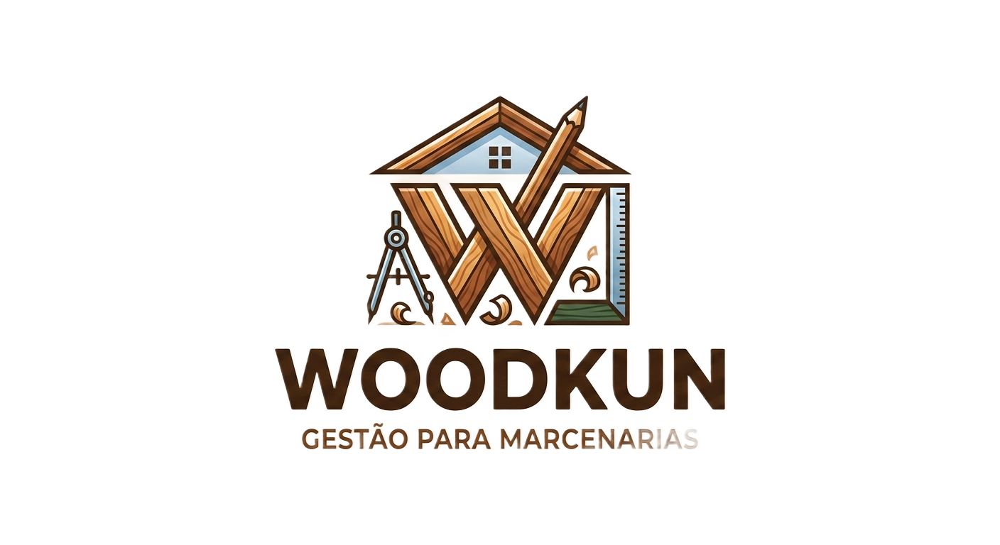

<p align="center">
  
</p>

<h1 align="center">WoodKun</h1>

<p align="center">Sistema de orçamentos para marcenaria</p>

---

O WoodKun ajuda a montar orçamentos de móveis planejados a partir dos materiais usados. Você cadastra os materiais com o preço por unidade, metro ou m², monta produtos (como uma escrivaninha) a partir desses materiais e usa materiais e produtos para montar orçamentos para seus clientes, exportando em PDF ou CSV.

## Funcionalidades

| Módulo | Status |
|---|---|
| Materiais: listagem, cadastro, edição e exclusão | ✅ Pronto |
| Clientes: listagem e cadastro, com busca de endereço pelo CEP e validação de CPF/CNPJ | ✅ Pronto |
| Produtos: cadastro com lista de materiais e cálculo do valor final | 📋 Planejado |
| Orçamentos: itens com quantidade e valor editáveis, exportação em PDF/CSV | 📋 Planejado |
| Início: listagem de orçamentos com filtros | 📋 Planejado |
| Imagens de materiais e produtos | 📋 Planejado |

## Tecnologias

- [Next.js 15](https://nextjs.org) (App Router) e React 19
- [Tailwind CSS 4](https://tailwindcss.com) e [shadcn/ui](https://ui.shadcn.com)
- [Drizzle ORM](https://orm.drizzle.team) com MySQL 8
- [TanStack Query](https://tanstack.com/query) para buscar e atualizar dados
- [TanStack Table](https://tanstack.com/table) para as listagens
- [React Hook Form](https://react-hook-form.com) e [Zod](https://zod.dev) para formulários e validação

## Como rodar

**Pré-requisitos:** Node.js 20+ e Docker.

```bash
# 1. Instale as dependências
npm install

# 2. Crie o arquivo de variáveis de ambiente
cp .env.example .env

# 3. Suba o MySQL (porta 3307)
docker compose up -d

# 4. Crie as tabelas e insira dados de exemplo
npm run db:migrate
npm run db:seed

# 5. Inicie o servidor
npm run dev
```

Acesse [http://localhost:3000](http://localhost:3000).

> O MySQL usa a porta **3307** para não conflitar com outro MySQL que já esteja rodando na 3306.

## Scripts

| Comando | O que faz |
|---|---|
| `npm run dev` | Servidor de desenvolvimento |
| `npm run build` | Build de produção |
| `npm run lint` | Verifica o código com ESLint |
| `npm run db:generate` | Gera uma migration a partir das mudanças em `src/db/schema.ts` |
| `npm run db:migrate` | Aplica as migrations pendentes no banco |
| `npm run db:seed` | Insere materiais e clientes de exemplo (só em tabelas vazias) |
| `npm run db:studio` | Abre o Drizzle Studio para visualizar o banco |

## Arquitetura

Toda leitura e escrita de dados passa por uma API REST:

```
Tela → hook do React Query → API REST → service → Drizzle → MySQL
```

```
src/
├── app/
│   ├── (modules)/          telas do sistema (/materiais, /clientes…)
│   └── api/                rotas da API REST (/api/materials…)
├── components/             componentes compartilhados (DataTable, shadcn)
├── db/                     schema do banco, conexão, constantes e seed
├── hooks/queries/          hooks do React Query que chamam a API
├── schemas/                schemas Zod, usados no formulário e na API
├── services/               acesso ao banco, usado só pela API
└── utils/                  helpers (formatação, cliente HTTP, API)
```

### API

Cada entidade segue o mesmo padrão. Exemplo com materiais:

| Método | Rota | Resposta |
|---|---|---|
| `GET` | `/api/materials` | `200` com a lista |
| `POST` | `/api/materials` | `201` com o material criado, ou `400` se os dados forem inválidos |
| `GET` | `/api/materials/:id` | `200` com o material, ou `404` |
| `PUT` | `/api/materials/:id` | `200` com o material atualizado, `400` ou `404` |
| `DELETE` | `/api/materials/:id` | `204`, `404`, ou `409` se o material estiver em uso |

## Convenções

- **Código e banco em inglês**: arquivos, variáveis, funções, tabelas e colunas.
- **Interface em português**: textos da tela, mensagens de erro e URLs das telas (`/materiais`, `/clientes`).
- **Telas de cadastro**: `/<modulo>/cadastro` cria um registro novo, e `/<modulo>/cadastro?id=1` edita o registro 1.

As regras completas estão no [CLAUDE.md](CLAUDE.md).
